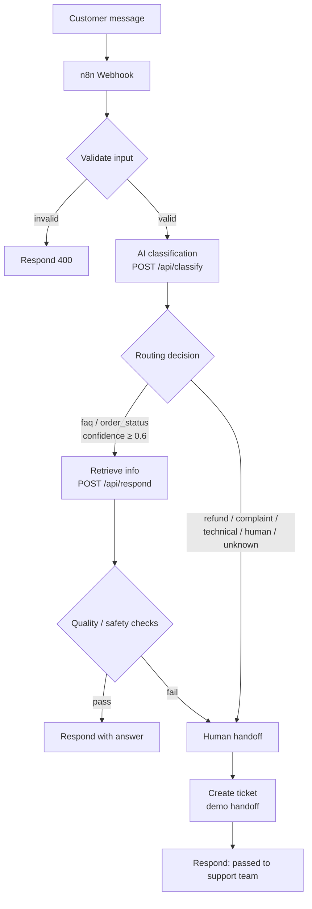

# AI Customer Support Automation

An automated first-line customer support system: an **n8n workflow** receives
customer messages via webhook, an **AI classifier** detects the intent from
structured JSON output, and the system either answers automatically (FAQs,
order status) or escalates to a human (refunds, complaints, technical issues,
uncertainty). A small **Python backend** holds the business logic; everything
runs locally with mock data — no API keys or paid services required.

## The business problem

Small e-commerce shops get the same kinds of messages every day:

- "Where is my order #1042?"
- "What is your return policy?"
- "I want a refund."
- "The checkout is broken!"

Answering these manually is slow and repetitive, but answering them *badly*
with AI is worse than not answering at all. The shop needs automation that:

1. understands what the customer wants,
2. answers the safe, routine cases instantly,
3. **hands off to a human** whenever it is unsure or the topic is sensitive.

## The solution

A webhook-triggered n8n workflow combined with a lightweight Python backend:

- The AI returns **structured JSON** (`intent`, `confidence`, `order_id`,
  `requires_human`, `reason`) — workflow decisions are never made from
  free-form LLM prose.
- Every AI response is **validated**; invalid output fails safely to human
  support.
- A **policy layer** forces escalation for refunds, complaints, technical
  problems, and low-confidence classifications, no matter what the model says.
- Routine cases (FAQs, order tracking) are answered automatically using a
  mock order database and FAQ knowledge base.

## Architecture



**Two parts, cleanly separated:**

| Part | Role |
|---|---|
| `n8n/customer-support-workflow.json` | Orchestration: webhook → validate → classify → route → respond / escalate |
| `src/` (Python, stdlib only) | Business logic: classification, order/FAQ lookup, answers, safety checks |

The backend also works standalone (`POST /api/handle` runs the whole
pipeline), so either side can be replaced independently. Details:
[docs/architecture.md](docs/architecture.md).

## Workflow explanation

Full walkthrough with examples: [docs/workflow.md](docs/workflow.md).
The short version:

1. **Webhook** — n8n receives `POST /webhook/customer-support` with
   `{ message, customer_id }`.
2. **Validate** — checks the `X-Webhook-Secret` header, requires a non-empty
   message, caps length at 2000 chars.
3. **Classify** — backend calls the LLM, which must return JSON like the
   example below. The JSON is strictly validated.
4. **Route** — auto-answer only for `faq` / `order_status` with confidence
   ≥ 0.6 and `requires_human: false`; everything else goes to the human
   handoff.
5. **Retrieve** — order number is extracted and looked up in the mock order
   DB; FAQ questions are matched against the FAQ base.
6. **Respond** — the answer passes quality/safety checks (length cap, no
   key-like text leaking), then goes back to the customer — or a ticket is
   created and the customer is told the support team will follow up.

## AI classification logic

The model is instructed (via system prompt) to reply with **only** this JSON:

```json
{
  "intent": "order_status",
  "confidence": 0.94,
  "order_id": "1042",
  "requires_human": false,
  "reason": "Customer is asking about an existing order"
}
```

Supported intents: `faq`, `order_status`, `refund_request`, `complaint`,
`technical_problem`, `human_support`, `unknown`.

The classifier then enforces three layers:

1. **Validation** — correct JSON? All fields present with the right types?
   Intent one of the seven? Confidence in 0–1? If anything is off → safe
   fallback (`unknown`, `requires_human: true`).
2. **Policy** — refunds, complaints, technical problems, explicit human
   requests, and unknown intents always escalate; confidence below the
   threshold (default 0.6) always escalates.
3. **Fail-safe** — model timeouts, API errors, or unexpected exceptions all
   become human escalations, never crashes or guesses.

**LLM provider is swappable:** `LLM_PROVIDER=mock` (default) uses a
deterministic rule-based demo classifier — clearly labeled as a demo, needs
no API key, and keeps tests offline. `LLM_PROVIDER=openai_compatible` calls
any OpenAI-style `/chat/completions` endpoint (OpenAI, Azure OpenAI, Ollama,
LM Studio, …).

## Example conversations

**Order tracking — answered automatically**
```text
Customer: Where is my order #1042?

System:   intent=order_status (0.93), order #1042 found
Answer:   "Good news — I found your order #1042! Status: shipped. Your parcel
           left our warehouse this morning and is with the carrier. Expected
           delivery: 2026-10-10. You can follow it here:
           https://example-carrier.local/track/DEMO1042"
```

**Refund — escalated to a human**
```text
Customer: I want a refund for order #1043, the item never arrived.

System:   intent=refund_request (0.92) → requires_human=true (policy)
Ticket:   { ticket_id: T-0007, priority: high, status: open }
Answer:   "Thanks for reaching out — I have passed your request to our support
           team. They will get back to you shortly."
```

**Missing order number — asks for clarification**
```text
Customer: Where is my order?

System:   intent=order_status, but no order number found
Answer:   "I'd be happy to check that for you! Could you please share your
           order number? It looks like '#1042' and you'll find it in your
           confirmation email."
```

## Technologies used

- **n8n** — workflow orchestration (webhook, branching, HTTP calls)
- **Python 3.10+ (standard library only)** — backend API and business logic,
  zero dependencies
- **REST APIs / webhooks / JSON** — all service communication
- **LLM APIs** — intent classification via a swappable provider
  (any OpenAI-compatible endpoint, or the built-in mock for demos/tests)
- **Mock JSON data** — order database and FAQ base (stand-ins for the real
  shop API and help center; clearly labeled as demo data)

## Setup instructions

**Requirements:** Python 3.10+, and n8n (only needed for the workflow part —
the backend and tests run without it).

```bash
git clone <your-repo-url> ai-customer-support-automation
cd ai-customer-support-automation

# 1. Configure (optional — the defaults run a full offline demo)
cp .env.example .env

# 2. Start the backend
python -m src.server
# → listening on http://127.0.0.1:8000, provider=mock

# 3. Run the tests
python -m unittest discover -s tests

# 4. Try it
curl -X POST http://127.0.0.1:8000/api/handle \
  -H 'Content-Type: application/json' \
  -d '{"message": "Where is my order #1042?"}'
```

More curl examples: `examples/sample-requests.sh`.

## Environment variables

| Variable | Default | Purpose |
|---|---|---|
| `LLM_PROVIDER` | `mock` | `mock` (demo classifier) or `openai_compatible` |
| `LLM_API_KEY` | — | API key, only for `openai_compatible` |
| `LLM_BASE_URL` | `https://api.openai.com/v1` | Chat-completions endpoint |
| `LLM_MODEL` | `gpt-4o-mini` | Model name for classification |
| `WEBHOOK_SECRET` | — | Shared secret sent as `X-Webhook-Secret`; empty = no check (local demo only) |
| `PORT` | `8000` | Backend port |
| `MAX_MESSAGE_LENGTH` | `2000` | Max customer message length |
| `CONFIDENCE_THRESHOLD` | `0.6` | Below this → human escalation |

See [.env.example](.env.example). Never commit a real `.env` — it is
git-ignored.

## How to import and run the n8n workflow

1. In n8n: **Workflows → Import from file** → select
   `n8n/customer-support-workflow.json`.
2. Set n8n environment variables: `BACKEND_URL` (default
   `http://localhost:8000`) and `WEBHOOK_SECRET` (must match the backend).
3. Start the backend: `python -m src.server`.
4. Activate the workflow. n8n gives you the webhook URL
   (`POST /webhook/customer-support`).
5. Test with the ready-made payloads in `examples/test-inputs.json`
   (n8n **Test workflow** mode → paste a `webhook_body` → compare with
   `expected`).

## Testing

```bash
python -m unittest discover -s tests
```

70 tests, all offline (mock provider). Coverage:

- the **10 required scenarios**: FAQ, order status, refund, complaint,
  technical problem, unclear message, missing order ID, invalid AI response,
  API failure, human escalation
- input validation, webhook secret checks, size limits
- classification validation + safe fallback + escalation policy
- mock order/FAQ data access
- HTTP layer: routing and 200/400/401/404 behavior
- n8n workflow JSON structure (valid nodes, connections, no hard-coded secrets)

Full breakdown: [docs/testing.md](docs/testing.md).

## Security considerations

- Secrets only via environment variables; `.env` is git-ignored, `.env.example`
  contains placeholders only.
- Webhook shared-secret check (`X-Webhook-Secret`, constant-time compare).
- Input validation on every request; 2000-char message cap; 64 KiB body cap.
- AI output is validated before use; failures escalate instead of being trusted.
- Generic error messages to clients — no stack traces or internals leaked.
- Ticket summaries store only a 200-char excerpt of the customer message;
  answers are scanned for key-like patterns before sending.
- The n8n workflow references secrets via `$env` only — nothing hard-coded.

## Limitations

- The default classifier is a **rule-based mock**, not a real model — it
  exists for offline demos and tests. Point `LLM_PROVIDER` at a real endpoint
  for production-like behavior.
- Orders and FAQs are **mock JSON files**, not a live shop integration.
- The human handoff is a **demo**: it returns a structured ticket as JSON.
  A real deployment would create tickets in Zendesk/Freshdesk or notify via
  Slack/email.
- FAQ matching is simple keyword overlap — fine for a demo, not for a large
  knowledge base.
- Single-process stdlib HTTP server — not hardened for high traffic.

## Future improvements

- Plug in a real LLM endpoint and evaluate classification accuracy on labeled
  examples.
- Replace the mock order DB with the shop's real API (Shopify/WooCommerce).
- Send handoff tickets to a real helpdesk (Zendesk/Freshdesk) or Slack channel.
- Add conversation memory (e.g. SQLite) for multi-turn dialogs.
- Add a small admin dashboard showing escalation stats and low-confidence cases.
- Expand the FAQ base and upgrade matching (embeddings) when it outgrows keywords.

## Repository structure

```text
ai-customer-support-automation/
├── README.md
├── .env.example
├── .gitignore
├── LICENSE
├── n8n/
│   └── customer-support-workflow.json   # importable n8n workflow
├── src/                                 # Python backend (stdlib only)
├── data/                                # mock orders + FAQs (demo data)
├── tests/                               # 70 automated tests
├── examples/                            # n8n test inputs + curl demos
├── docs/                                # architecture, workflow, testing
└── screenshots/                         # add n8n screenshots after import
```
